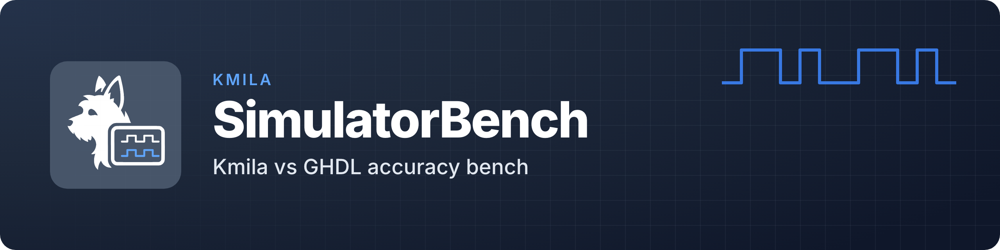
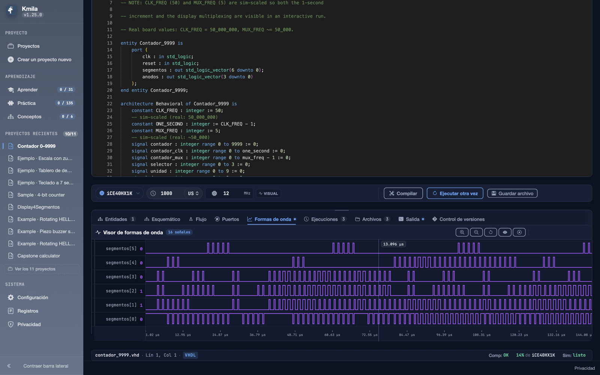
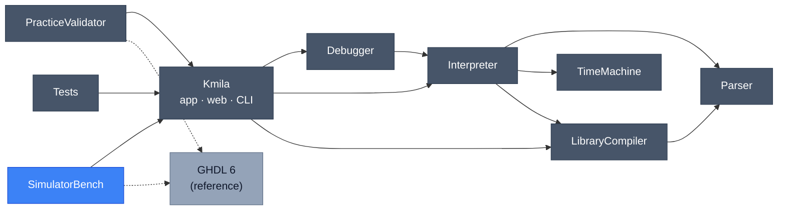

<p align="right"><a href="README.es.md">Español</a></p>

<p align="center"></p>

<p align="center"><a href="LICENSE"></a> <a href="https://dotnet.microsoft.com/"></a> <a href="https://kmila.com.mx"></a> <a href="https://github.com/Kmila9s/SimulatorBench/releases"></a></p>

<p align="center">
  <a href="https://kmila.com.mx/demo"><b>Try the browser demo</b></a> · <a href="https://kmila.com.mx">Website</a> · <a href="https://github.com/Kmila9s/Documentation/releases">User manual (PDF) and thesis</a>
</p>

## What it is

The accuracy harness behind Kmila: each case is simulated verbatim in Kmila and in GHDL and the waveforms are compared strictly (nine-valued, including t = 0). Known differences are tracked in `known-gaps.json` with a ratchet.

<p align="center"></p>

## Quick start

```bash
# requires the Kmila repo next to this one and GHDL 6 on PATH
dotnet run -c Release -- list          # cases and their variants
dotnet run -c Release -- run           # verbatim, in process
```

## Where it fits



<sub>Arrows point from a project to what it uses (project references). The highlighted box is this repository.</sub>

## Documentation

- [Technical reference (architecture, API, changelog)](docs/reference.md)
- [User manual (PDF) and thesis](https://github.com/Kmila9s/Documentation/releases)

## The Kmila family

| | | |
|---|---|---|
|  | [**Kmila**](https://github.com/Kmila9s/Kmila) | Write, simulate and debug HDL without an FPGA |
|  | [**Parser**](https://github.com/Kmila9s/Parser) | VHDL lexer and front-door parsing for Kmila |
|  | [**Interpreter**](https://github.com/Kmila9s/Interpreter) | Delta-cycle HDL simulation engine and synthesis |
|  | [**Debugger**](https://github.com/Kmila9s/Debugger) | Structural checks and lint for VHDL designs |
|  | [**LibraryCompiler**](https://github.com/Kmila9s/LibraryCompiler) | IEEE libraries, use clauses and primitive lowering |
|  | [**TimeMachine**](https://github.com/Kmila9s/TimeMachine) | Discrete time base: ticks, clocks and events |
|  | [**PracticeValidator**](https://github.com/Kmila9s/PracticeValidator) | Validates every practice against GHDL |
|  | [**Tests**](https://github.com/Kmila9s/Tests) | Unit, end-to-end and performance suites |
|  | [**Documentation**](https://github.com/Kmila9s/Documentation/releases) | Thesis and user manual (PDF) |

## Contributing

Issues and merge requests are welcome; see [CONTRIBUTING.md](CONTRIBUTING.md).

## License

MIT © 2026 Ulrich Tamayo Daniel. See [LICENSE](LICENSE).

<sub>Developed as the degree project TT 2026-B059 at IPN ESCOM (Mexico).</sub>
